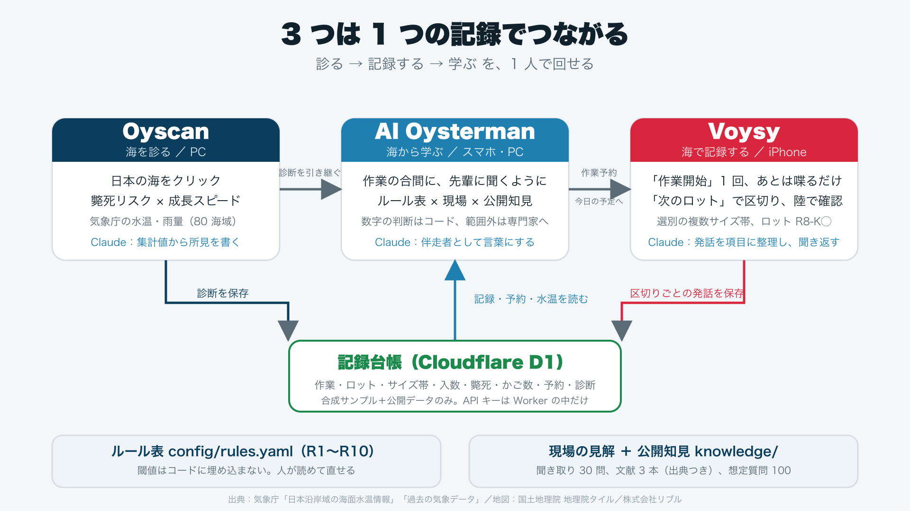
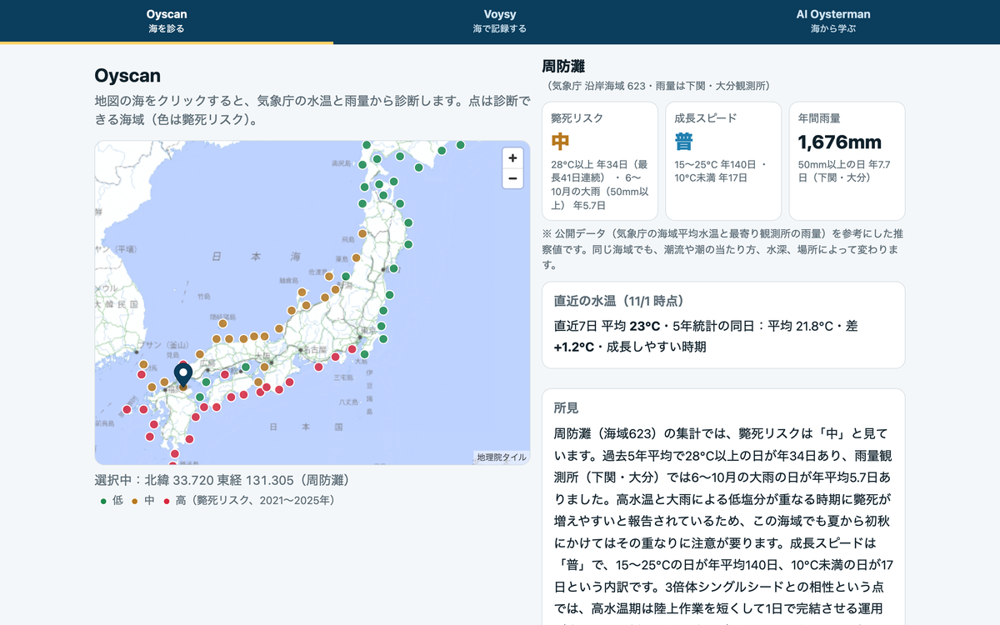
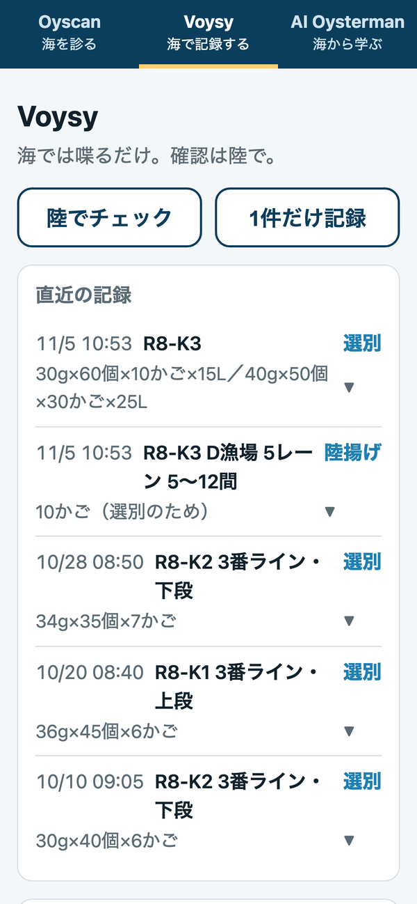
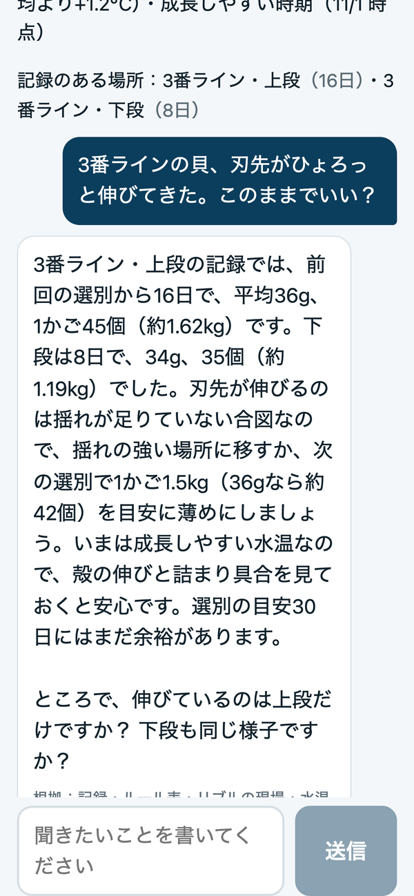

# OysterPilot

**牡蠣養殖（シングルシード）を新しく始める人の前にある 3 つの壁を、Claude を組み込んだ 3 つの道具で取り払う。**
Oyscan（海を診る）→ Voysy（海で記録する）→ AI Oysterman（海から学ぶ）

[English](#english)

- デモ動画：https://youtu.be/C3iMZNPLu3k（2 分 59 秒。ナレーションは合成音声）
- 公開 URL：https://oysterpilot.oysterpilot-api.workers.dev （共有パスワードは提出フォームに記載）
- 作者：高畑 拓弥（株式会社リブル 取締役・経営企画室長）
- Built with Claude: Japan 2026 提出作品（2026-11-02 〜 11-08）

## 1. 解きたいこと

牡蠣は餌も淡水も要らない動物性タンパク質で、養殖二枚貝は水産物の中で環境負荷が最も低い部類に入ります（Gephart et al. 2021, *Nature*）。一方で漁業就業者は 2023 年に約 12.1 万人、約 4 割が 65 歳以上（水産白書）。使われていない漁場と担い手を求める自治体があり、新しく始める人が沿岸の仕事になります。

その人の前に 3 つの壁があります。

1. **判断できない** … その海で育つか、始める前に分からない。適地評価は専門家頼み。
2. **記録が残らない** … 濡れた手・揺れる船で入力できない。記録が途切れると助言もできない。
3. **相談相手がいない** … シングルシード養殖は独特で、一般の AI では答えにならない。

株式会社リブルは 2018 年から、牡蠣養殖の立ち上げ支援を人の手でやってきました。OysterPilot はそれを AI で誰でも受けられる形にする試みです。

## 2. 3 つのアプリ

| | Oyscan（海を診る） | Voysy（海で記録する） | AI Oysterman（海から学ぶ） |
|---|---|---|---|
| 一言 | 日本の海をクリックすると、水温と雨量から診断が出る | 船上で喋り続けるだけで、記録に変わる | 作業の合間に、隣の先輩に聞くように相談する |
| 使う人・端末 | 自治体・漁協の担当者／PC | 生産者／iPhone | 生産者／スマホ・PC |
| Claude の役割 | 集計値から所見を書く | 発話を項目に構造化し、足りない項目を聞き返す | 記録・水温・成立ルール・知識を読んで、伴走者として答える |



### Oyscan — 日本中の海を診る



地図（地理院タイル）に本土沿岸 80 海域の点が出ます。海をクリックすると最寄りの海域を選び、気象庁の海面水温（沿岸海域の平均）と最寄り観測所の雨量から、直近 5 年の指標を即時に出します。

- **斃死リスク 低／中／高**：28℃以上の日数と、6〜10 月に 1 日 50mm 以上降った日数の組み合わせ。高水温と大雨（低塩分）が重なる時期に斃死が増えやすいと報告されていることに基づく目安です。
- **成長スピード 良／普／鈍**：15〜25℃の日数。10℃未満が長い海域は 1 段下げます。
- **年間雨量**、直近 7 日平均と 5 年統計の同日との差、季節区分。
- Claude が 4〜6 文の所見を書き、「AI Oysterman に引き継いで相談する」で渡せます。

閾値は全国の分布を見て決めた目安で、`config/rules.yaml` にあります。判定は水温と雨量のみ。公開データを参考にした推察値で、同じ海域でも潮流や潮の当たり方、水深で変わること、塩分・流れ・水深は要現地測定であること、出荷の安全は都道府県の検査結果で確認することを画面に明記しています。

### Voysy — 海では喋るだけ、確認は陸で



「作業開始」を 1 回押せば、あとは喋りながら作業を続けられます。

- 「次のロット」などの合図語で記録を区切り、区切りごとの生の文をその場で保存（Claude は呼ばない。圏外なら端末に残して再送）
- 「記録終了」の言葉、またはボタンで止める
- 文字起こしと並行して生音声も端末に残します（1 回の作業につき 1 ファイル、合図の位置は頭出しの印に）。陸でチェックの各区切りと確認表から「この区切りを聞く」で、その区切りの声だけを聞き直せます。残したい録音は共有シートからファイルやドライブへ出せます。録音を始められない端末では文字だけで続きます。
- 陸で「陸でチェック」を開くと、区切りごとの文を直し、「整理する」で Claude（`claude-haiku-5-5`、JSON Schema の構造化出力）が **作業ごとの型** に整理します。陸揚げ（海上）は場所（D漁場 5レーン 5〜12間）・かご数・目的、沖出し（海上）は場所とかご数、選別（陸上）はサイズ帯（サイズ・入数・かご数・かごの種類）・斃死・殻の状態・身入り・付着物。選別は帯ごとに 1 件の記録として保存
- 項目に入らない発言はメモに全部残す。ロット番号は `R8-K3`（令和 8 年度・3 回目の採苗）の型で読み、200g 超のサイズなど聞き間違いの疑いがある数字は空欄にして確認に回す。言わなかった項目は催促しない。確定するのは人
- 短い記録は「1件だけ記録」（録音→確認→保存）でも入れられる

音声認識はブラウザの Web Speech API（iPhone Safari）。Web アプリの制約で、最初の 1 タップと画面の点灯は必要です。

### AI Oysterman — 伴走者



「今日ってどの作業がいいかな？」「最近の水温ってどう？」「死んだ貝が増えてきた」「台風が来る」。場所を選ばせず、記録のある全場所と今日の予約、水温（5 年統計との差・季節区分）を読み、`config/rules.yaml` の 10 ルールをコードで判定したうえで、Claude（`claude-sonnet-5-5`）が先輩の口調で答えます。

答えは 4 層に分けています。

| 層 | 中身 | 置き場所 |
|---|---|---|
| ルール表 | 閾値と成立条件（R1〜R10）。数字の判断はここだけ | `config/rules.yaml` |
| リブルの現場 | 現場の目安・作業規律・話し方（聞き取り 30 問） | `knowledge/reblue_views.md` |
| 公開知見 | 文献・県水試・水産庁・海外普及資料の要点（出典つき） | `knowledge/digest.md`、`knowledge/notes_*.md` |
| 一般的な知見 | 出漁の目安、ライン間隔、病気の見方、種苗の入手経路、衛生と生食用の仕組み、漁業権・補助金・共済の流れなど。仕組みと目安まで答え、確認先の種類を添える | `knowledge/general_qa.md` |
| 範囲外 | 個別の可否や数字の断定（今出荷していいか、いくらで売れるか、儲かるか）。一般論を言ったうえで「先輩に聞く項目」に整理する | プロンプトの線引き |

斃死の原因は断定せず、密度・水温・雨量・場所・時期・青潮や赤潮の順に「見てみましょう」と並べます。判断に足りないことは 1 つだけ聞き返し、提案は「この作業を予約する」で Voysy の予定に書き戻します。各返答の下に根拠の種別（記録・ルール表・リブルの現場・公開知見）を小さく表示します。想定質問 100 問（`knowledge/questions.md`）で検証し、禁止語 0・範囲外の判定は想定どおりでした（`knowledge/eval_2026-11-02.md`）。

## 3. ルール表と、なぜ「ルール ＋ Claude」なのか

| ID | 条件 | 言うこと（要旨） |
|---|---|---|
| R1 | 28℃以上が 7 日以上 | 高水温が続いています。作業時間を短くして負担をかけない |
| R2 | 10℃未満が 7 日以上 | 生育が鈍る時期。選別の間隔を少し空ける（30 日 → 45 日） |
| R3 | 15〜25℃で、前回選別から 15 日以上 | かなり成長しているかも。殻の伸びや詰まりを見てみましょう |
| R4 | 選別・入数の話題 | 入数はかご容量の 1/4 を目安に（15L で約 1.5kg、25L で約 2.0kg） |
| R5 | 殻（刃先）が伸びている | 揺れが足りていない合図。揺れの強い場所へ、入数は薄めに |
| R6 | 殻がツルツル | 揺れが強すぎる合図。静穏な場所へ、入数を上げる |
| R7 | 前回選別から目安日数を超えた | 貝をチェックする目安を過ぎています。殻の形と詰まりを見て、必要なら選別 |
| R8 | 前回の選別で斃死 20% 以上 | 多めです。原因は一つに決めず、密度・水温・雨量・場所・時期・青潮や赤潮の順に |
| R9 | 直近 7 日平均 26℃以上 | 陸上の作業は短く、陸揚げ→選別→かご詰め→沖出しを 1 日で完結 |
| R10 | 台風・大雨の話題 | 前はラックを下段へ。通過後は塩分と貝の色を見て、直後の選別は避ける |

閾値は `config/rules.yaml` にあり、コードに埋め込んでいません。**数字の判断は LLM に任せず**、コードが「いま成立しているルール」を決めてから Claude に渡します。Claude が担うのは、記録の数字を引用した言い回し、聞き返し、予約の構造化です。ルールは人が読めて直せる形で残し、「死にます」「必ず」「予測」のような断定は使わない方針をプロンプトとサーバー側の検査の両方で守っています。文献とリブルの見解が食い違うところ（干出の付着抑制効果など）は現場を優先し、文献は「海域によるとの報告」と添えます。

## 4. 使ったデータと出典

- 気象庁「日本沿岸域の海面水温情報」：沿岸海域 98 区分の日別（2016 年〜）と 5 年統計。`scripts/fetch_scan_areas.ts` で取得して同梱。
- 気象庁「過去の気象データ」：気象官署 33 か所の日降水量 5 年分。各海域は最寄り 2 観測所の距離加重平均。
- 地図：国土地理院 地理院タイル（淡色地図）。
- 公開知見：水産庁、都道府県水産試験場（広島・岡山・三重・岩手・佐賀・熊本・福岡・大分ほか）、宮城県の三倍体ガイドライン、海外の普及資料（Auburn 大学、BIM、NSW DPI、タスマニア大学ほか）、査読論文。出典は `knowledge/notes_*.md` に URL つきで列挙。
- 作業記録のサンプル（`data/seed_records.csv`）は合成データです。実在の漁場名・実績データは含みません。

> 出典：気象庁「日本沿岸域の海面水温情報」（沿岸海域の平均・実績値）、気象庁「過去の気象データ」（気象官署の日降水量）を加工して株式会社リブル作成。水温は海域全体の平均値、雨量は最寄りの観測所の値で、個別地点の値とは異なります。予報ではありません。
> 地図：国土地理院 地理院タイル。
> 本診断は水温と雨量のみに基づく参考情報です。出荷の安全（貝毒・衛生基準）は都道府県の検査結果でご確認ください。

## 5. 技術構成

- フロント：Vite + React（1 つの SPA、3 画面）。地図は MapLibre GL JS（Oyscan を開いたときだけ読み込み）。音声は Web Speech API。
- API：Hono on Cloudflare Workers。フロントも同じ Worker から配信（Static Assets）。台帳は Cloudflare D1。
- Claude API：`claude-haiku-5-5`（Voysy の構造化、JSON Schema による構造化出力）、`claude-sonnet-5-5`（AI Oysterman の会話、Oyscan の所見）。予約と範囲外判定は tool use で構造化。知識を含む約 1.5 万トークンのシステムプロンプトはプロンプトキャッシュに載せ、毎回送るのは記録・水温・成立ルールの約 900 トークンだけ。API キーは Workers の secret にのみ置き、フロントに出しません。
- 共有パスワード：`X-Demo-Key` ヘッダ。審査用の簡易保護です。
- テスト：ルール判定・場所解決・文字起こしの正規化・録音範囲の単体テスト 24 件（`pnpm test`）。会話評価 25 ケース（デモ・一般論・範囲外・曖昧・断定誘導、`pnpm eval`）。想定質問 153 問の一括検証（`pnpm sweep`）。会話ログ（`chat_logs`）から答えられなかった質問を洗い出して知見を足す。Voysy は読み取り結果と人が直した記録の差分を `pnpm accuracy` で集計し、崩れ方の対応表を育てる。
- 開発の仕組み（Claude Code）：スキル 3 件（用語と言い回し `.claude/skills/oyster-glossary`、本番運用の手順 `prod-ops`、ルール表・用語集・知見を変える手順 `rules-change`）、ルール表の矛盾を検出するエージェント `.claude/agents/rules-reviewer`、実名・秘密情報を止めるコミット前フック（`.githooks/pre-commit`、Claude Code の `git commit` 直前にも同じ検査）。判断の記録は `docs/99_decisions.md`。

## 6. セットアップ

要件は `docs/`、Claude Code への指示は `CLAUDE.md`、判断の記録は `docs/99_decisions.md`、知識は `knowledge/`。

```
pnpm i
cp apps/api/.dev.vars.example apps/api/.dev.vars   # ANTHROPIC_API_KEY, DEMO_KEY（ローカルは空でも可）
pnpm -C apps/api d1:migrate:local && pnpm -C apps/api seed:local
pnpm dev                                             # web(5173) + api(8787)。/api は Vite が 8787 へ中継
pnpm test                                            # ルール判定の単体テスト
pnpm eval                                            # 会話評価（ローカル API に 16 ケースを流す。EVAL_URL/DEMO_KEY で本番も可）
```

データの更新（任意。気象庁から取り直して同梱 JSON を作り直す）：

```
node scripts/fetch_jma.ts            # 周防灘の日別（AI Oysterman の水温コンテキスト）
node scripts/fetch_scan_areas.ts     # 全国の海域指標と雨量（Oyscan）。取得結果は .cache/ に保存
```

デプロイ（初回は `wrangler login` → `pnpm -C apps/api d1:create` → `wrangler.jsonc` の `database_id` を置換）：

```
pnpm -C apps/api d1:migrate && pnpm -C apps/api seed
pnpm -C apps/api exec wrangler secret put ANTHROPIC_API_KEY
pnpm -C apps/api exec wrangler secret put DEMO_KEY
pnpm deploy
```

## 7. 1 週間で割り切ったこと／今後の展開

割り切ったこと：Oyscan の判定は水温と雨量のみで、地点→海域は最寄り中心点の簡易判定。認証は共有パスワード。会話履歴はブラウザ内だけ。合図語は固定の一覧。

今後の展開：

- Voysy の起動を「画面にさわらない」形にする。今回は Web の制約で港での 1 タップが要るが、本実装では次の 2 つを想定している
  - ネイティブアプリ：Siri に「Voysy、作業開始」と言えば音声の取り込みが始まり、ポケットの中でも認識し続ける（最初の 1 タップと画面点灯の制約を外す）
  - 電話番号：IP 電話の番号に電話をかけると Voysy につながり、喋った内容がそのまま区切りとして残る。同じ電話で AI Oysterman との会話もできる（スマホの画面も、アプリの導入も要らない）
- 推移グラフ、殻高の記録、塩分・流れ・安全性（貝毒・衛生）の診断、離島を含む全海域、潮流の考慮
- 音声での相談、作業規律の追加（ルール表と「リブルの見解」を現場ごとに育てる）

## 8. ライセンス・作者

MIT License。高畑 拓弥（株式会社リブル）。

---

# English

**OysterPilot removes the three walls in front of people starting single‑seed oyster farming, with three tools built on Claude.**
Oyscan (read the sea) → Voysy (record at sea) → AI Oysterman (learn from the sea)

- Demo video: https://youtu.be/C3iMZNPLu3k (2:59; narration is synthesized)
- Live URL: https://oysterpilot.oysterpilot-api.workers.dev (shared password provided in the submission form)
- Author: Takuya Takahata (Director, Re:Blue Inc.)
- Entry for Built with Claude: Japan 2026 (Nov 2–8, 2026)

## Why

Oysters need no feed and no fresh water, and farmed bivalves are among the lowest‑impact animal proteins (Gephart et al. 2021, *Nature*). Japan had about 121,000 fishers in 2023, roughly 40% of them aged 65 or older (Fisheries White Paper). Unused fishing grounds and municipalities looking for newcomers exist. Yet a newcomer faces three walls: they cannot judge whether a sea will grow oysters, they cannot keep records with wet hands on a moving boat, and there is no one to ask about single‑seed farming, where generic AI does not help. Re:Blue has supported new oyster farms by hand since 2018. OysterPilot turns that support into something anyone can use.

## The three apps

| | Oyscan | Voysy | AI Oysterman |
|---|---|---|---|
| In one line | Click any coast of Japan and get a diagnosis from water temperature and rainfall | Keep talking while you work; it becomes records | Ask like you would ask a senior farmer next to you |
| Who / device | Municipal or co‑op staff / PC | Farmers / iPhone | Farmers / phone or PC |
| Claude's role | Writes the findings from aggregated numbers | Structures speech into record fields and asks about missing ones | Answers as a companion from records, temperature, fired rules and a knowledge base |

<p>  </p>

**Oyscan.** A map of Japan shows 80 coastal sea areas as dots. Click the sea and the nearest area is selected. From five years of JMA sea‑surface temperature (area averages) and daily rainfall at the nearest JMA stations, three indicators appear instantly: **mortality risk (low/mid/high)** from days at or above 28°C combined with heavy‑rain days (≥50 mm) in June–October; **growth speed (good/normal/slow)** from days at 15–25°C, lowered when days below 10°C are many; and annual rainfall, plus the last 7‑day mean against the 5‑year statistics. Claude then writes a 4–6 sentence finding that can be handed to AI Oysterman. Thresholds live in `config/rules.yaml` and were set from the nationwide distribution. The page states that the values are estimates from public data, that conditions differ within an area by current, exposure and depth, and that food‑safety clearance comes from the prefecture.

**Voysy.** Record at sea, review on land. Tap "Start work" once and keep talking. Cue words such as "next lot" split records; each segment's raw transcript is saved immediately (no LLM call; queued offline if out of range). Say "end recording" or tap to stop. Raw audio is recorded alongside recognition and kept on the device (one file per session, cue positions saved as markers), so each segment's own audio can be replayed next to its text on land ("Listen to this segment"), and the file exported via the share sheet; devices that cannot record continue with text only. On land, open "Review", fix the text if needed, and "Organize": Claude (`claude-haiku-5-5`, structured output) sorts the speech into the form for each job. Landing (at sea): place (farm D, lane 5, bays 5–12), basket count, purpose. Deployment (at sea): place and basket count. Grading (on land): size bands (size, count per basket, baskets, basket type), mortality, shell state, meat condition, fouling. Each size band becomes its own record; anything that fits no field is kept verbatim in notes. Lot numbers follow `R8-K3` (fiscal year R8, third spat batch). Implausible numbers (e.g. a 330 g oyster from a misheard "30") are blanked for confirmation; nothing is nagged for. A person makes the record final.

**AI Oysterman.** "What should I do today?", "How is the water lately?", "More oysters are dying", "A typhoon is coming." No location selector: it reads every location's records, today's reservations and the temperature context, evaluates ten rules in code, and Claude (`claude-sonnet-5-5`) answers in the voice of a senior farmer and companion. Answers draw on four layers: the rule table (the only place numbers are judged), Re:Blue's field practice (30 interview answers), public knowledge (prefectural research stations, the Fisheries Agency, extension material from Auburn, BIM, NSW DPI, Tasmania; cited in `knowledge/`), and out‑of‑scope topics (disease, hygiene, sales, licensing) that are handed to experts without assertion. It never states a single cause of mortality; it lists what to check. Each reply shows which layers it used. A 100‑question evaluation (`knowledge/eval_2026-11-02.md`) found no banned phrasing and correct out‑of‑scope handling.

## Rules + Claude

Thresholds live in `config/rules.yaml`, not in code. Numeric judgment is never delegated to the LLM: code decides which rules fire, and Claude handles wording, follow‑up questions and structured reservations. Rules stay human‑readable and editable, and assertive phrasing ("will die", "always", "forecast") is banned by both the prompt and a server‑side check. Where literature and field practice differ (e.g. whether air exposure controls fouling), field practice leads and the literature is cited as "reported to vary by area".

## Data and attribution

JMA coastal sea‑surface temperature for 98 areas (daily since 2016, 5‑year statistics) and daily precipitation at 33 JMA stations, fetched once by `scripts/fetch_scan_areas.ts` and bundled (no runtime calls to JMA). Map tiles by the Geospatial Information Authority of Japan (GSI). Sample records are synthetic; no real farm names or performance data. Diagnoses use temperature and rainfall only and are not forecasts.

## Stack

Vite + React SPA, MapLibre GL JS (lazy‑loaded), Web Speech API; Hono on Cloudflare Workers serving the SPA as static assets; Cloudflare D1; Claude API (`claude-haiku-5-5` for extraction, `claude-sonnet-5-5` for conversation and findings, tool use for reservations, prompt caching for the ~15k‑token knowledge prompt). The API key lives only in Workers secrets. A shared password (`X-Demo-Key`) protects the demo. 13 unit tests for rule evaluation and location resolution, plus a 16‑case conversation evaluation (`pnpm eval`: demo, out‑of‑scope, ambiguity, assertion‑baiting; 16/16). Claude Code tooling in the repo: three skills (`oyster-glossary` for terms and phrasing rules, `prod-ops` for the production runbook, `rules-change` for the procedure when the rule table, glossary or field knowledge changes), a `rules-reviewer` agent (contradiction check for the rule table) and a pre‑commit hook that blocks real farm names and secrets.

## Setup

See the Japanese section above; the commands are identical (`pnpm i`, local D1 migrate and seed, `pnpm dev`, `pnpm test`, `pnpm deploy`; `node scripts/fetch_scan_areas.ts` refreshes the nationwide dataset).

## Trade‑offs and what's next

Scope was cut to temperature‑and‑rainfall diagnosis with nearest‑centroid area matching, a shared password, in‑browser chat history and a fixed cue‑word list. Next: starting Voysy without touching a screen — in production we envision a native app launched by Siri ("Voysy, start work" begins capture, even in a pocket) and a phone‑number model (call an IP phone number, speak, and the recording is kept; the same call can continue as a conversation with AI Oysterman) — then trend charts and shell‑height records, salinity/current/safety diagnostics, remote islands and currents, voice consultation, and growing the rule table and field knowledge per farm.

MIT License. Takuya Takahata, Re:Blue Inc.
